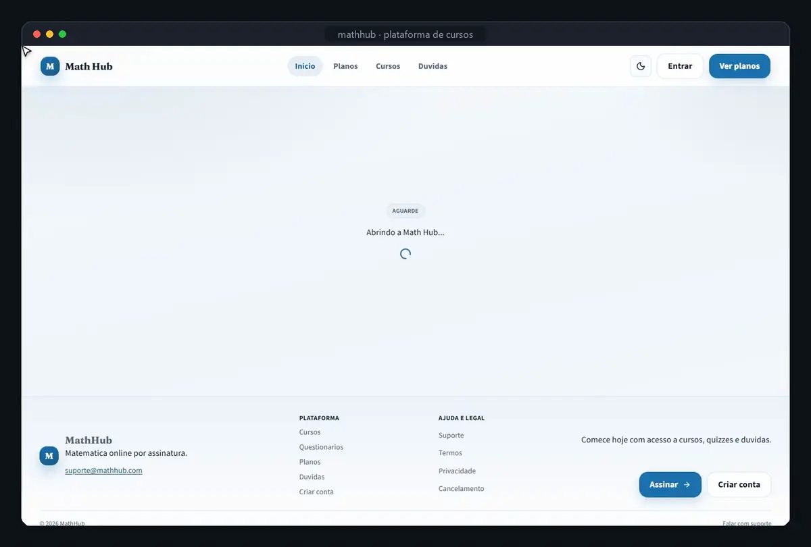
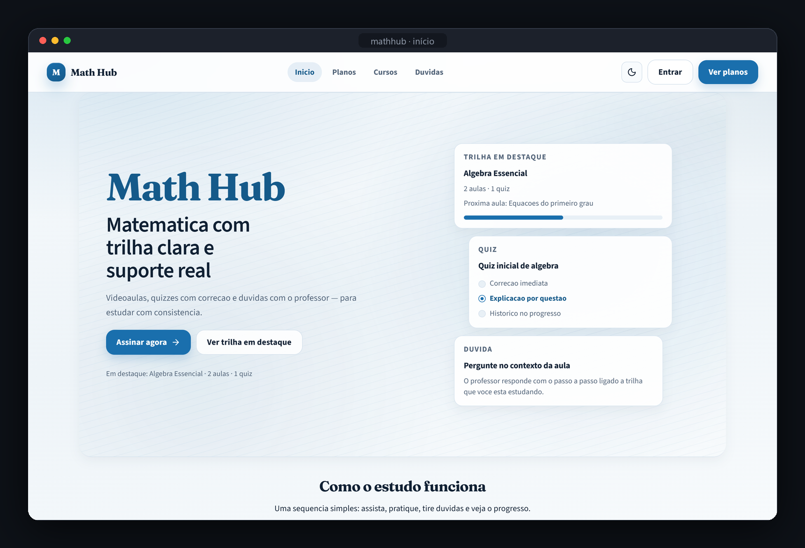
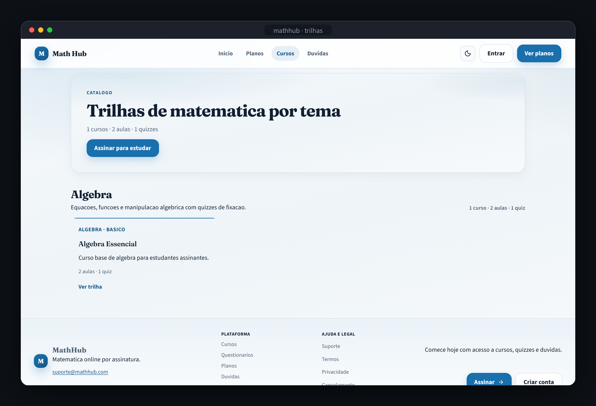
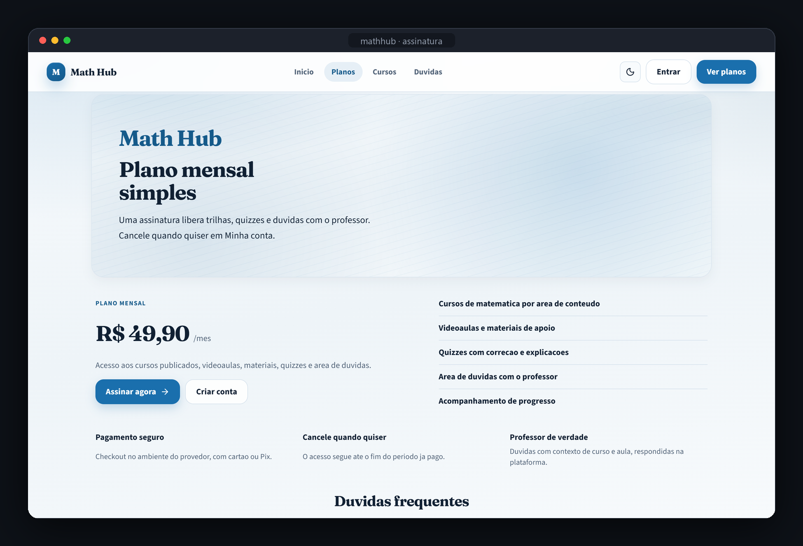

<h1 align="center">MathHub</h1>

<b>A plataforma para o professor de matemática vender seus cursos online.</b> 
Aulas em vídeo, materiais, quizzes com correção e dúvidas com o professor, tudo numa assinatura mensal.

  
  

---

## O problema que ele resolve

O professor que ensina bem costuma vender mal: grava aula no YouTube, manda material no WhatsApp, cobra no Pix e responde dúvida
no meio da noite, tudo espalhado. O aluno se perde e o professor não sabe quem está estudando.

**O MathHub junta tudo num lugar só**, com a cara do professor e cobrança automática.

## Para quem

| | |
|---|---|
| 👩‍🏫 **Professor** | publica trilhas, aulas, materiais e quizzes, e responde as dúvidas no contexto da aula |
| 🎓 **Aluno assinante** | assiste, pratica, tira dúvida e acompanha o próprio progresso |
| 🛠️ **Administrador** | acompanha usuários, pagamentos, auditoria e a saúde da plataforma |

## 📸 Telas

  

  
  

  
  
  

## O que tem dentro

**Para estudar**
- Trilhas por tema com aulas em vídeo e materiais protegidos para baixar
- Banco de questões e **quizzes com correção e explicação** de cada resposta
- **Dúvidas no contexto da aula**, respondidas pelo professor
- Progresso do aluno em cada trilha

**Para vender**
- Assinatura mensal com cancelamento simples
- Pagamento com Mercado Pago e confirmação automática
- Página de planos, perguntas frequentes e e-mails automáticos

**Para operar**
- Áreas separadas para aluno, professor e administrador
- Painel administrativo com auditoria e status da plataforma
- Funciona no celular como app (PWA) e tem tema escuro

## Construído com

`Next.js` · `TypeScript` · `Prisma` · `PostgreSQL` · `Mercado Pago` · `PWA`

Login com sessão segura, controle de acesso por perfil, limite de tentativas e registro de auditoria.

---

  🔒 <b>Código privado.</b> O MathHub é um produto comercial; este repositório é só a vitrine. 
  Quer ver por dentro, contratar ou levar para a sua escola? <a href="https://www.linkedin.com/in/yuri-medeiros-1071533b4/"><b>Fale comigo no LinkedIn</b></a>.

Feito por <a href="https://github.com/ymedeiros228">Yuri Medeiros</a>

